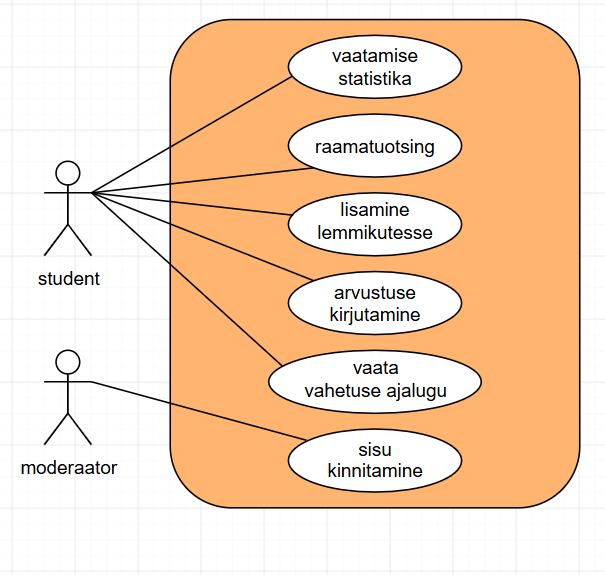
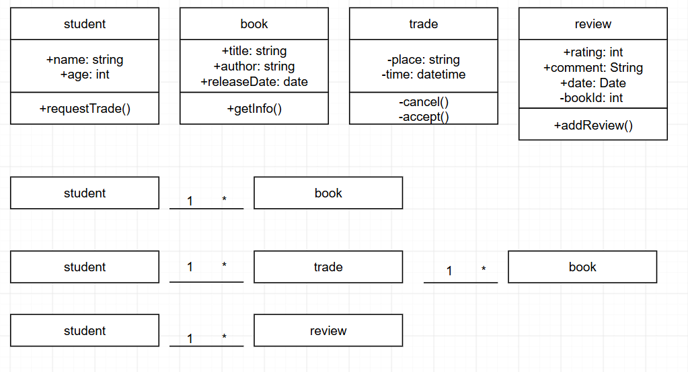
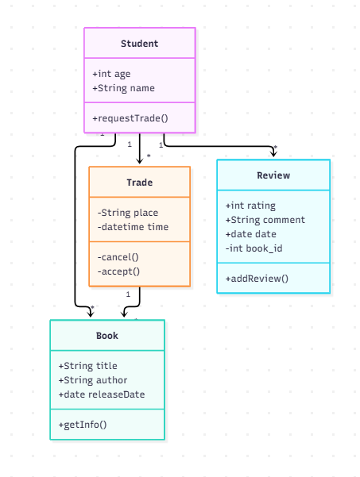
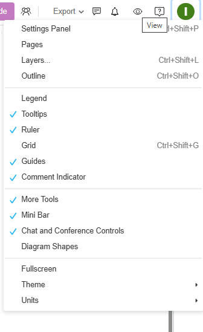
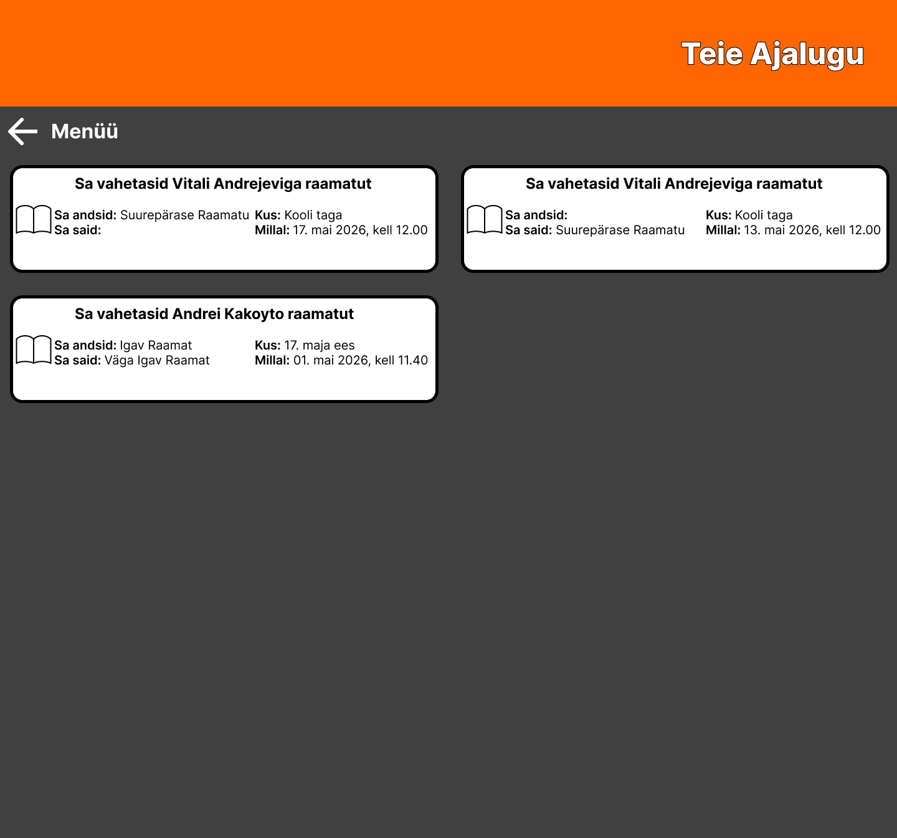
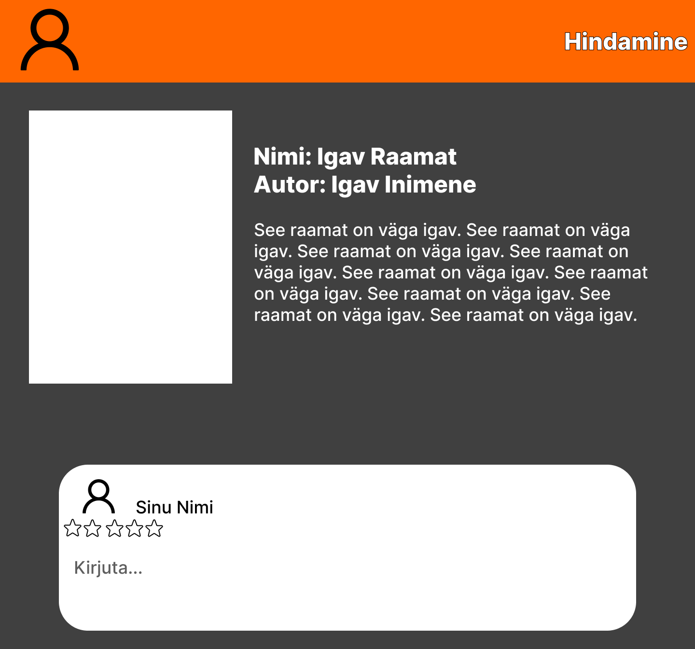

# Raamatuvahetus
Süsteem õpilastele raamatute vahetamiseks

**Autorid:** Ivan Sotnikov · NPTV24 Grupp

## Kasutajad ja nõuded
Kaks rolli: õpilane ja moderaator. Probleemide osas on kuus (8) kasutajalugu,
kõige olulisemad on märgitud kui „kohustuslikud“.

## Arendusmudel
Teeme seda järk-järgult, sest nii meile see ülesanne antigi. Meile anti üks ülesanne ja me täitsime selle. Kui olime selle lõpetanud, liikusime edasi järgmise juurde.

## Diagrammid
Statistika, statistika, lisamine, kirjutamine, vaata vahetuse ajalugu, sisu kinnitamine 

Üliõpilane, statistika, kaubandus, ülevaade 

 	classDiagram
  class Student {
    +int age
    +String name
    +requestTrade()
  }
    class Book {
    +String title
    +String author
    +date releaseDate
    +getInfo()
  }
    class Exchange {
    -String place
    -datetime time
    -cancel() 
    -accept()
  }
    class Review {
    +int rating
    +String comment
    +date date
    -int book_id
    +addReview()
  }
  Student "1" --> "*" Book
  Student "1" --> "*" Exchange
  Exchange "1" --> "*" Book
  Student "1" --> "*" Review

  VP
  1. Vaates polnud "paanide" paneeli 
  2. Ma ei tea, mis draw.io-s juhtuks.

## Vastused
1. Pärast klassi ümbernimetamist näitasid commitid reamuudatusi: vanad read punasega ja uued read rohelisega.

2. Kui oleksin PNG-faili asendanud, oleksid muudatused näidanud eemaldatud vana PNG-faili ja lisatud uut.

3. Nad peavad nimesid jälgima, et kõik ei oleks igal pool erinevalt nimetatud.

## Paigutus
Tegime seda inkrementaalselt, sest arvasin, et nii on mugavam töötada.)
 

## Vahendid
Raamatuvahetuse süsteemi jaoks valisime draw.io, kuna seda on brauseris lihtne kasutada. Me ei vali PlantUML-i ega Mermaid'i, kuna need on tekstipõhised. Kui meeskond oleks suurem, valiksime ikkagi draw.io.
## Kuidas me töötasime
Tahv alguses ja lõpus: `protsess/`. Kolmelauseline tagasivaade:
Enamik ülesandeid täideti probleemideta. Välja arvatud kuues ülesanne. See nõudis ühendamist ja pidi hõlmama meeskonnatööd, aga ma töötasin üksi.

## Projektikaart

**Teelija:** Õpilane, kes soovib raamatuid vahetada
**Probleem:** Praegu on võimatu kindlaks teha, kas raamat on hea või mitte. Teave on saadaval ainult õpilase antud kirjelduse põhjal, kes seda teise raamatu vastu vahetab.

**Eesmärk:** Pärast projekti valmimist on raamatu kvaliteeti lihtne rakendusest lahkumata kindlaks teha.

**Tulemus:**

* Identsete raamatute jaoks lisatakse arvustussüsteem.

* Lisatakse täiendavat tehisintellekti teavet.

* Raamatute arutelude jaoks lisatakse vestlused.

**Kolmnurk:** Aeg: Paindlik; Raha/Inimesed: Puudub; töömaht: mitte väike. Fikseeritud: Aeg ja töömaht

**Rollid:** Klient - Õpilane; Projektijuht - Mina; Meeskond - Programmeerijad; Sidusrühmad - Õpilased ja moderaatorid

| Risk | Tõenäosus 1-3 | Mõju 1-3 | Mida me kõigepealt teeme |

| Tehisintellekt hallutsineerib mingit jama | 3 | 2 | Proovib erinevaid tehisintellekti seadeid või mudelit, mis keelab tal ebausaldusväärsetest allikatest teabe hankimise |

| Kasutud kommentaarid | 2 | 1 | Modereerimine kustutab põhjendamatud arvustused |

| Vestluse rämpspost | 1 | 2 | Moderaator blokeerib nad |

**Edukriteeriumid:** Kui klient saab teha teadliku otsuse raamatu kvaliteedi kohta ilma rakendusest lahkumata

Asjad, mida klient võib vajada, aga mida me selles projektis ei tee:
* Raamatute jagamiste ajaloo ja arvu vaatamine
* ​​"Sarnaste raamatute" soovitamine tehisintellekti abil
* Raamatu omaniku profiili ja arvustuste vaatamine.
